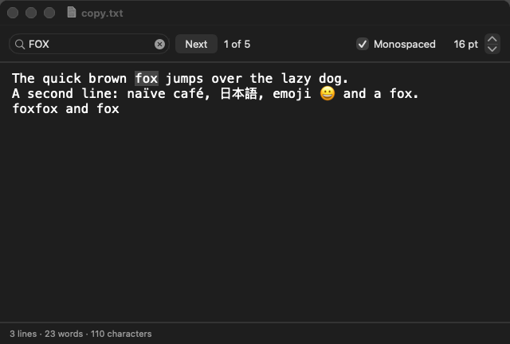

# loup-macos-notepad — a plain-text editor for macOS, in Loup



It is built on [loup-macos-appkit](https://github.com/myronccai/loup-macos-appkit),
the Loup library of proxy classes over AppKit (package `appkit`), which is
also where the gate script for all the example apps lives.

## Getting started

Requirements:

- macOS on Apple silicon or Intel, with the Xcode Command Line Tools
  (`xcode-select --install`).
- A Loup toolchain of version newer than 1.27.0, with `loup`, `loup-build`,
  `loup-llvm`, `loup-test` and `loup-bootstrap` on `PATH`. The app needs
  fixes made after the 1.27.0 release ([Loup releases](https://github.com/code-craft-ai-company/loup-releases/releases)).

Get the code: the app depends on the appkit library through
`appkit = { path = "../loup-macos-appkit" }` in `loup-macos-notepad.lppkg`, so
clone both repositories into the same directory:

```sh
git clone https://github.com/myronccai/loup-macos-appkit
git clone https://github.com/myronccai/loup-macos-notepad
cd loup-macos-notepad
```

Build, run, test and self-test it (from inside `loup-macos-notepad`):

```sh
loup build                                     # build ./loup-macos-notepad
./loup-macos-notepad                           # run the app
loup test --strict src                         # the logic tests
./loup-macos-notepad --self-test | diff selftest.out -   # the self-test
bash ../loup-macos-appkit/run_all.sh loup-macos-notepad  # all of it, both drivers
```

If linking fails with "tapi error … unknown architecture", point `SDKROOT`
at an older SDK, for example:

```sh
export SDKROOT=/Library/Developer/CommandLineTools/SDKs/MacOSX26.5.sdk
```

## What it does

One window for editing a UTF-8 text file:

- **The text area** fills the window: plain text (pasting drops styles), undo
  and redo, no smart quotes or dashes. New and Open… start a fresh undo
  history.
- **File menu** (right after the app menu): New (⌘N), Open… (⌘O), Save (⌘S)
  and Save As… (⇧⌘S), through the standard Open and Save panels. A file
  that cannot be opened (missing, unreadable, not UTF-8) or saved is
  reported with the reason, and the document stays as it was.
- **The window title** shows the file name ("Untitled" before the first save)
  and " — Edited" while the text differs from the saved text (so undoing back
  to it clears the mark); the close button shows the unsaved dot and the title
  bar the file's proxy icon.
- **Unsaved changes** are never lost silently: New, Open…, closing the window
  and Quit (⌘Q, the Dock's Quit, logging out) ask *Save / Don't Save /
  Cancel* first — also while the window is minimized or the app is hidden.
  Save on an untitled document asks where to save it; cancelling that panel
  cancels the whole action. If asking or saving fails with an error, the
  window stays open and the app keeps running (appkit refuses a close or
  quit whose check throws).
- **The status bar** shows lines, words and characters, updated on every
  edit, undo and redo.
- **Find**: the search field (⌘F, or Edit ▸ Find ▸ Find…) counts the
  matches as you type ("5 matches"); Next, Return in the field or ⌘G selects
  the next match after the selection or the insertion point ("2 of 5"),
  wrapping at the end. After an edit, a change of the query or opening
  another file, the label shows the count again until the next Next, so it
  never names a match that is not the one selected. Matching counts
  overlapping matches and ignores letter case in every script: a letter
  matches its lower case wherever that is a single character
  (`char.toLower()`), and final ς matches σ; letters whose case forms differ
  in length (ß / SS, İ / i̇) are matched exactly.
- **Font**: a stepper sets the size (9–36 pt) and a Monospaced check box
  switches between the system font and the fixed-pitch font.

Closing the window quits the app (after the unsaved-changes question). The
window can be made as narrow as the toolbar's controls (its natural width,
which depends on the system font) and 240 pt high.

## Build, run, test

Requires macOS, the Xcode Command Line Tools and the Loup toolchain (newer than
1.27.0) on `PATH`, with
[loup-macos-appkit](https://github.com/myronccai/loup-macos-appkit) checked
out next to this repository (see [Getting started](#getting-started)).

```sh
loup build                              # self-hosted: loup-build → loup-llvm → clang
loup-bootstrap build --target native    # or the Stage0 route
./loup-macos-notepad                    # the app
loup test --strict src                  # the logic tests (interpreted)
```

`bash ../loup-macos-appkit/run_all.sh loup-macos-notepad` does all of it with
both drivers and compares each build's self-test with `selftest.out`;
`bash ../loup-macos-appkit/run_all.sh --screenshots loup-macos-notepad` also
refreshes `screenshot.png`.

`./loup-macos-notepad --self-test [png]` (run it under lldb, as `run_all.sh`
does) uses the app as a person would, invisibly. It checks that the window
keeps its minimum size (the toolbar fits in it), types three lines into the
text area (accents, CJK and an emoji included) and reads the status bar. It
types "fox" into the Find field and clicks Next, presses Return and clicks
Next until the matches wrap, then searches for "FOX" from the selected match.
It steps the font size up three times, ticks Monospaced and reads the text
view's font back. It chooses File ▸ Save with a canned Save-panel answer
(`appkit.dialogs.setTestAnswers`) in the app's `.temp/`, edits again (the
match label goes back to the count), chooses Edit ▸ Undo (the " — Edited"
mark goes) and presses ⇧⌘Z (it comes back). It chooses New and answers the
unsaved-changes alert with Cancel, then Don't Save (the undo history is
gone); types into the new document and chooses Open…, answering Save (and a
Save-panel path) before the Open panel reopens the first file; saves a copy
with Save As…; tries to open a file that is not UTF-8 (an alert says so and
the document stays); and presses ⌘G. After each step it prints the window
title, the status bar, the match label and the selected text — read from
the controls — and the alerts it answered. It then writes the snapshot to
`png`, edits once more and presses ⌘W, answering Cancel (the window stays
open and the close button keeps its unsaved dot, read back with
`Window.isDocumentEdited`). It presses ⌘W once more with no answer queued, so
the unsaved-changes alert throws: appkit refuses the close and the window
stays open (`setHandlerErrorsFatal(false)` keeps that error from ending the
self-test; `handlerErrorCount` shows it was reported). Finally it takes the
window off screen (`Window.hide`, as minimizing or hiding the app does; the
title bar still names the file) and asks whether the app may quit while the
check throws (no), then presses ⌘Q, which goes through `[NSApp terminate:]`:
Cancel keeps it running. Asked again (`shouldQuit`), Save writes the file
(the unsaved dot goes), and the last `quit()` ends the app without asking.
No real dialog ever appears.

The self-test runs inside one timer, so AppKit never ends an "event" between
its steps; `TextArea.endUndoStep()` closes the undo step where a key press
would have ended, so one Undo takes back one step.

## Structure

| File | Mode | What it holds |
|---|---|---|
| `src/main.lphc` | `host.native` | The window, the menus and the handlers (built from the appkit proxies), file reading and writing, the close / quit checks, and the `--self-test` driver. |
| `src/textstats.loup` | `host.dual` | `textStats` (lines, words, characters as Unicode scalars; "\n", "\r\n" and "\r" breaks) and the status bar's text. |
| `src/find.loup` | `host.dual` | `findAll` (case-folded, overlapping matches) and the `FindState` value behind Next (from the selection) and the match label. |
| `src/document.loup` | `host.dual` | The `Document` value (path, saved text, edited — the current text differs from the saved text) and what the title, the Save panel and the unsaved-changes alert show for it. |
| `src/*_test.lpscr` | `host.scripted` | `loup test` tests of the three logic modules: Unicode, empty text, line breaks, overlapping and case-insensitive matches in several scripts, Next from a selection or an insertion point and its wrap, titles, undoing back to the saved text. |
| `selftest.out` | | The exact output of `./loup-macos-notepad --self-test`. |

The logic modules know nothing about AppKit, so they run under `loup run` and
`loup test`; `main.lphc` keeps all the state in two module-level values
(`Document`, `FindState`) and the views in one `Ui` object, and every handler
is a plain module function. An edit, an undo and a redo (`TextArea.onEdited`)
fetch the text from the text view once and hand it to the edited check, the
status bar and the match count.

## appkit modules used

| Module | What the app uses |
|---|---|
| `appkit.app` | `appInit`, `Window` (`setContent` / `content`, `fitToContent` / `contentSize` / `setMinSize` / `minSize` / `setContentSize`, `setTitle`, `setRepresentedFilename` / `representedFilename` (the proxy icon), `setDocumentEdited` / `isDocumentEdited` (the unsaved dot), `isVisible`, `hide`, `onShouldClose`, `sendKey`, `snapshot`), `onShouldQuit` / `shouldQuit` / `quit`, `Menu` / `MenuItem` (`addItem`, `addSubmenu`, `itemWithTitle`, `perform`), `insertMenu` (File after the app menu), `editMenu` (Edit ▸ Find), `menuBar().sendKey` (⌘Q), `after`, `run`, `isSelfTest`, `executableDir` (where the self-test's `.temp/` goes), `setHandlerErrorsFatal` / `handlerErrorCount` (the self-test's throwing close and quit checks), `MOD_*`. |
| `appkit.controls` | `SearchField` (`typeText`, `submit`), `Button`, `Label` (`applyTextColor(systemColor(COLOR_SECONDARY_LABEL))`), `Checkbox`, `Stepper`, `Font.isFixedPitch` (the self-test's font check), `TEXT_RIGHT`. |
| `appkit.layout` | `VStack` / `HStack` (toolbar row, separators, the expanding text area, the status bar), `setMinSize`, `layoutNow` (the self-test's minimum-size check). |
| `appkit.text` | `TextArea` (`usePlainText`, `setTextInset`, `onEdited`, `text` / `setText`, `setFont` / `font`, `selectedRange` / `setSelectedRange` / `selectedText` / `scrollRangeToVisible`, `moveToStart` / `moveToEnd`, `insert`, `focus`, `canUndo`, `breakUndoCoalescing`, `clearUndoHistory`, `endUndoStep`), `utf16Offset` / `scalarIndex`. |
| `appkit.dialogs` | `alert` (unsaved changes), `info` (open / save failures), `openFile`, `saveFile`, `readTextFile` / `writeTextFile`, `setTestAnswers`, `testAnswersLeft`, `testLog`. |

## Raw Objective-C left

None: the app does not import `appkit.objc`. The represented file, the
document-edited mark, the window's visibility, hiding it, its minimum size,
the font's fixed pitch and the executable's directory all have appkit APIs
now.

The close and quit checks need no exception handling of their own either:
appkit refuses a close or quit whose `onShouldClose` / `onShouldQuit` handler
throws, so a failure there keeps the document and its edits (the self-test
checks both).

## Toolchain bugs

None are worked around any more. The two this app used to avoid are fixed:
an `IoError` from `io.fs` is now caught by `catch` on every route (the app
reads and writes the user's files with `appkit.dialogs.readTextFile` /
`writeTextFile` anyway, for Foundation's description of a failure and the
UTF-8 check), and `char.toLower()` maps non-ASCII letters in native builds as
the interpreter does (so `find.foldChar` uses it instead of its own table).

## License

MIT; see [LICENSE](LICENSE). Copyright (c) 2026 Code Craft AI LLC.
The appkit library it is built on is
[loup-macos-appkit](https://github.com/myronccai/loup-macos-appkit).
